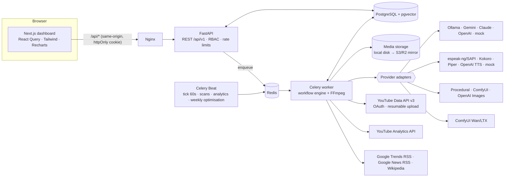

# Architecture

A **modular monolith**: one FastAPI codebase whose modules (agents, integrations, video engine, workflows, workers) talk through plain Python interfaces and the database. They can be split into services later (for example, a dedicated render service), because every cross-module hand-off already goes through persisted state.



Without Docker (`TASK_MODE=inline`), Redis, Celery and Beat are replaced by an in-process worker thread plus a 60-second scheduler loop that call **the same job functions** (`app/workers/jobs.py`).

## The 12 agents

| # | Agent | Module | Notes |
|---|---|---|---|
| 1 | Trend Discovery | `agents/trends.py::discover` | `videos.list?chart=mostPopular` (region + category), one `search.list` per niche per scan (100 quota units), Google Trends daily RSS, Google News RSS, evergreen fallback. Stores a snapshot on every sighting. |
| 2 | Trend Intelligence | `agents/trends.py::score_trend`, `suggest_ideas` | Weighted score: velocity 25, engagement 20, search 20, freshness 15, relevance 10, feasibility 10 (configurable). Feasibility is penalised for topics that would need copyrighted footage (music videos, trailers, highlights). The LLM explains *why* a topic works and proposes distinct angles. |
| 3 | Content Research | `agents/content.py::research` | Wikipedia (in the channel language where possible) plus dated news for time-sensitive niches. Facts must cite a fetched URL, otherwise they are downgraded. Fails the topic if no sources are found. |
| 4 | Copyright & Originality | `agents/compliance.py` | Checks 4-gram overlap with the trending reference, 6-gram verbatim copying from each source, cosine + 5-gram repetition against the channel's previous scripts (inauthentic-content policy), a trademark/franchise blocklist, child-safety terms and asset licence provenance. On a similarity failure the script is rewritten (up to 2×); after that the run fails. |
| 5 | Scriptwriting | `agents/content.py::write_script` | Format-specific structure (hook ≤3s → value → CTA), word budget from target duration, avoids previous hooks, uses optimisation insights. |
| 6 | SEO & Metadata | `agents/content.py::generate_metadata` | Title ≤100 chars, tags ≤480 chars, hashtags kept only if related to the script, sources + AI disclosure in the description. |
| 7 | Voice | `agents/media.py::generate_voice` | One WAV per scene, idempotent, with a licence note per provider. |
| 8 | Visuals | `agents/media.py::generate_visuals` | One image per scene (seeded for consistency) plus optional AI clips for the first N scenes, each with an `asset_licenses` row. |
| 9 | Video Production | `agents/media.py::render_video`, `video_engine/renderer.py` | Per-scene Ken Burns + caption overlays + dip transitions → concat → original synthesized music bed → `loudnorm I=-14` → H.264/AAC `+faststart`. SRT sidecar plus a 1280×720 thumbnail. |
| 10 | Quality Assurance | `agents/qa.py` | 16 weighted checks producing a 0–100 score. Critical failures block publishing regardless of score. Default minimum 85. |
| 11 | Publishing | `agents/publishing.py` | Approval-gated, one idempotency key per video, the session URL is persisted *before* bytes are sent (so a crash resumes instead of duplicating), quota-aware, `publishAt` scheduling, `containsSyntheticMedia` and `selfDeclaredMadeForKids` set. Success is recorded only from YouTube's response. |
| 12 | Analytics & Optimisation | `agents/analytics.py` | Data API stats + Analytics API metrics per video, labelled 24h/48h/7d/28d windows. A weekly optimisation pass writes insights used by scoring and scriptwriting. Read-only toward YouTube. |

## Workflow engine (`app/workflows/pipeline.py`)

```
research → script → [script_review] → originality → seo → voice → visuals → render → qa → approval → publish
```

- Each step's `status / output / error` is stored in `workflow_runs.steps`. `advance()` skips `done` steps, which gives resume-from-last-success.
- A row lease (`locked_until`) prevents two workers from processing the same run.
- Retryable errors back off exponentially (2, 4, 8 minutes; 4 attempts), then the run fails and a critical notification is sent (dead letter).
- `BudgetExceeded` pauses the run and the automation and notifies you. Raising the budget resumes it.
- Human gates (script review, publish approval) put the run into `waiting_approval`. API decisions set it back to `pending`.
- Studio edits reset only the affected steps and delete only the affected assets.

**Why not LangGraph?** The spec suggested it. Our pipeline is a fixed DAG with human gates and must survive restarts between steps that can be hours apart. A ~300-line persisted state machine gives DB-native resumability, row locking and per-step audit without a second checkpoint store. The step handlers are plain functions, so wrapping them in a LangGraph `StateGraph` later is mechanical if branching agent behaviour is needed.

## Data model

29 tables (Alembic `0001_initial_schema`): the 28 in the specification plus `workflow_runs`. Secrets live only in Fernet-encrypted columns (`channels.oauth_token_enc`, `ai_providers.api_key_enc`), which are never serialised by the API (`api/deps.py::SECRET_FIELDS`). `scripts.embedding` is `vector(384)` on PostgreSQL (pgvector) and JSON on SQLite.

## Security

httpOnly SameSite=Lax session cookie (JWT), bcrypt passwords, RBAC (admin / editor / viewer), slowapi rate limits (login 10/min, global 120/min), signed OAuth `state`, minimal Google scopes (`youtube.upload`, `youtube.readonly`, `yt-analytics.readonly`; broader scopes are opt-in), token revocation on disconnect, audit log for every mutation, authenticated media serving with path-traversal guard, security headers in Nginx, non-root containers.
